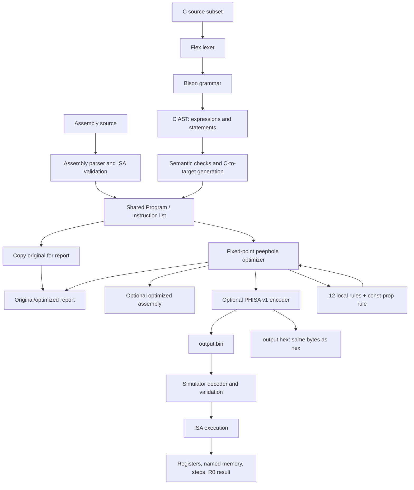

# Compiler Design Lab Presentation Material

**Project:** Peephole Optimizer for a Simple Target Instruction Set  
**Repository:** `Peephole-optimizer`  
**Course / lab:** [Course and lab section]  
**Team:** [Team name or number]  
**Team members:** [Name, roll number] · [Name, roll number] · [Name, roll number]  
**Instructor:** [Instructor name]  
**Presentation date:** [Date]

> This report describes the checked-out implementation and records the test mismatch found during this inspection. Treat the slide content as verified implementation evidence, not as a claim that every current test is green.

## 1. Executive summary

This project is a teaching compiler pipeline and C11 peephole optimizer. It accepts either the project's assembly language or a deliberately small subset of C. Assembly is parsed directly into a shared instruction-list representation. C is tokenized by Flex, parsed by Bison into a small AST, and translated to the same instruction list. A fixed-point optimizer applies local rewrites and a later constant-propagation/branch-folding pass. The result can be printed as target assembly, encoded in the custom PHISA v1 binary format, rendered as a hexadecimal dump, and executed by the project's simulator.

The current ISA has eight signed 64-bit registers, named scalar memory, arithmetic and shift operations, comparisons, conditional and unconditional jumps, NOP, and HALT. It is a teaching ISA: the binary is custom bytecode, not native machine code and not an executable for a physical CPU.

On the current `samples/input.c`, the compiler reports **19 → 13 instructions**, estimated cost **32 → 24**, **8 cost units / 25.00% saved**, **3 optimization passes**, and **12 rewrites**. The optimized PHISA binary ran in the simulator and returned **200**. A temporary comparison harness encoded and simulated both the generated pre-optimization program and its optimized version; both returned **200**.

The current C sample multiplies 10 by 20 and returns 200. The frontend and CLI tests now use the current sample and include loop execution checks against both original and optimized code.

## 2. Verified project features

### Implemented

- Assembly parsing with opcode, operand, label, and duplicate/undefined-label validation.
- A Flex/Bison frontend for one `int main() { ... }` function, with local integer declarations, assignments, arithmetic expressions, return, nested blocks, `if`, `if-else`, `while`, `do-while`, `for`, six comparisons, and truthy integer conditions.
- An AST for expressions, declarations, blocks, assignments, returns, and conditionals.
- Translation of C AST nodes into the same `Program` / `Instruction` representation used by assembly input.
- Thirteen selectable optimizer rules: twelve local rules plus `const-prop`.
- A fixed-point optimizer with label validation after every pass and a 1,000-pass convergence limit.
- Text target-assembly output, PHISA v1 binary output, and a hex dump of the same bytes.
- A PHISA v1 simulator with register and sparse named-memory state, arithmetic, comparisons, branches, HALT, diagnostics, and an instruction limit.
- Parser, optimizer-rule, compiler frontend, CLI, and simulator tests.

### Implementation stack

- **Implementation language:** C11, with the GCC/Clang overflow builtins used for checked optimizer/simulator arithmetic.
- **Frontend generators:** Flex lexer and Bison parser; generated C snapshots are checked in and included by `src/parser.c`.
- **Build/test tooling:** `build.sh` is the documented non-Make build; `Makefile` provides optional Make targets; shell scripts drive integration tests.
- **Libraries:** C standard library and POSIX shell utilities; no external runtime/library dependency is used by the compiler or simulator.

### ISA summary

| Instruction form | Implemented behavior |
|---|---|
| `LD Rd, #n` / `LD Rd, name` | Load a signed immediate or named memory value into a register. |
| `ST name, Rs` | Store a register value in a named scalar location. |
| `MOV Rd, Rs` | Copy a register. |
| `ADD/SUB/MUL/DIV Rd, Rs, Rt-or-#n` | Signed integer arithmetic; result goes to Rd. Division truncates toward zero; zero divisor and signed overflow are runtime faults. |
| `SHL/SHR Rd, Rs, Rt-or-#n` | Shift the signed source. Simulator accepts a nonnegative source and count 0–62; left shift also traps if the result overflows. |
| `CMP Ra, Rb` | Set signed comparison relation for the next comparison branch. |
| `JMP label` | Unconditional branch. |
| `JZ/JNZ Rs, label` | Branch if the selected register equals / differs from zero. |
| `JLT/JGT/JLE/JGE/JE/JNE label` | Branch on the signed relation set by the immediately preceding CMP. |
| `NOP` / `HALT` | No operation / stop execution. Compiler return values are in R0. |

Labels are parser/optimizer constructs; the encoder omits them and writes resolved zero-based executable-record targets.

### Not implemented

- A complete C compiler, general-purpose C frontend, native code generation, register allocation, linker, or physical CPU backend.
- General C logical operators, `break`, `continue`, increment/decrement operators, and comma expressions. `for` initialization and update support declaration/assignment forms only.
- Runtime benchmarking or a claim that these rewrites improve wall-clock execution time.
- A merge-aware dataflow optimizer that reconciles facts from multiple incoming control-flow paths.

## 3. Architecture and workflow

There are two front doors and a shared target representation:

1. **Assembly path:** `parse_file` reads lines and creates validated `Instruction` records. Labels remain pseudo-instructions in the in-memory `Program`.
2. **C path:** Flex recognizes tokens; Bison builds the AST through the constructors in `c_ast.h`; `parse_c_text` walks that tree, performs name/scope checks while generating instructions, and emits unique memory slots and labels.
3. **Optimizer:** `peephole_run` clones the parsed program, retains the original for reporting, and calls `optimize`. The optimizer repeats rule scans until a pass makes no changes.
4. **Outputs:** the CLI prints original and optimized target instructions, counts/costs/rewrite log, and optionally writes assembly, PHISA binary, and/or PHISA hex.
5. **Execution:** the separate `simulator` executable loads PHISA v1 bytes, validates and decodes each record, then executes from instruction index zero.

There is no separate low-level IR between the AST and target instructions: the C AST is translated directly to the shared `Program` representation. The binary and hex outputs are optional CLI products; the simulator consumes the binary.

## 4. Implemented optimization rules

The original twelve rules are still registered in `RULE_ALL`; `const-prop` is a thirteenth rule. The first twelve rules run in the local instruction-list scan in `apply_rules`; constant propagation and CFG reachability pruning run after that scan. The optimizer repeats both until a no-change pass.

| # | Rule | Original → optimized pattern | Why valid / conditions | Test evidence |
|---|---|---|---|---|
| 1 | Redundant load after store | `ST x, R1; LD R1, x` → `ST x, R1` | Removes the immediate reload because the stored register still contains the value. Requires adjacent instructions, same memory name, and same register. | `test_redundant_load` in `tests/test_rules.c`; positive and overwrite/label/name negatives. |
| 2 | Load to register copy | `ST x, R1; LD R2, x` → `ST x, R1; MOV R2, R1` | The immediately preceding store supplies the value for that same memory location. Requires adjacency and equal memory names. | `test_load_copy`; positive and label/name/register-overwrite negatives. |
| 3 | Redundant store | `ST x, R1; ST x, R1` → `ST x, R1` | The earlier store already put the same unchanged register value in the same named location. Backward scan stops at labels, branches, HALT, a write to that memory, or a write to the source register. | `test_stores`; same-value case and boundary/write negatives. |
| 4 | Algebraic identity | `ADD Rd, Rs, #0` or `MUL Rd, Rs, #1` → `MOV Rd, Rs` | Addition by zero and multiplication by one preserve the source value. The original local rule only handles those exact immediate forms. | `test_arithmetic`; identity and nonidentity cases. |
| 5 | Multiply by zero | `MUL Rd, Rs, #0` → `LD Rd, #0` | The result is zero for every source value; the operation cannot overflow. | `test_arithmetic`; zero and nonzero multiplier cases. |
| 6 | Self-move removal | `MOV R1, R1` → (removed) | The instruction cannot change machine state. | `test_arithmetic`; self-move and distinct-register cases. |
| 7 | Strength reduction | `LD Rs, #x; MUL Rd, Rs, #2^k` → `LD Rs, #x; SHL Rd, Rs, #k` | Only rewrites a positive power-of-two immediate when a prior immediate load proves the source is nonnegative and the product fits signed 64-bit range. Known-register search does not cross labels, branches, HALT, or a register write. | `test_arithmetic`; safe, unknown, negative, overflow, non-power-of-two, and overwritten-source cases. |
| 8 | Constant folding | `LD Rs, #x; OP Rd, Rs, #y` → `LD Rd, #result` | Supports ADD/SUB/MUL/DIV/SHL/SHR when the source constant is known in the same straight-line region and the operation passes overflow, divide, and shift checks. | `test_arithmetic`; safe fold plus overwrite, label, overflow, zero-divisor, and shift negatives. |
| 9 | Jump to next label | `JMP L; L:` → `L:` | The jump already falls through to its destination. | `test_control_flow`; adjacent label and intervening-instruction cases. |
| 10 | Jump chaining | `JMP A; A: JMP B` → `JMP B; A: JMP B` | Resolves finite unconditional-jump chains. Cyclic chains are left unchanged. | `test_control_flow`; finite-chain and cyclic-chain cases. |
| 11 | Unreachable code removal | `JMP L; NOP; ...; L:` → `JMP L; L:` | A direct unconditional jump cannot execute the straight-line instructions before the next label. The next label is retained as a target. | `test_control_flow`; removal, target-label preservation, and conditional-branch negative. |
| 12 | Dead-store elimination | `ST x, R1; ST x, R2` → `ST x, R2` | The first store is unobservable if a later store overwrites the same location before any read. Scan stops at a label, branch, or HALT. | `test_stores`; overwrite-before-read, read-first, different-location, and control-boundary cases. |
| 13 | Constant propagation and branch folding (`const-prop`) | Known `ST x, R` / `LD R, x` → known immediate; known arithmetic/comparison/condition → immediate or simplified branch; proven dead path → removed | Tracks constants through registers and named-memory stores within a straight-line scan; folds safe arithmetic and identities, known CMP conditions, and known JZ/JNZ conditions. A proven-taken conditional becomes JMP; a proven-false conditional is removed. Then a reachability walk removes instructions outside reachable CFG paths. Facts are cleared at labels and branch boundaries; it does not merge different facts at joins. | `tests/cli_test.sh` verifies the rule can be selected and rewrites; `tests/test_c_frontend.c` checks constant/unknown branch examples; `tests/test_simulator.c` checks behavior when its expectations match the source fixture. Current sample expectations in the latter two test files are stale (see §6). |

### Rule-registration notes

`src/rules.h` assigns bits 0–11 to the original rules and bit 12 to `RULE_CONST_PROP`; `RULE_ALL=(1u<<13)-1`. `parse_rules` in `src/main.c` exposes names including `load-after-store`, `load-copy`, `redundant-store`, `algebra`, `mul-zero`, `self-move`, `strength`, `fold`, `next-jump`, `jump-chain`, `unreachable`, `dead-store`, and `const-prop`. The default is all registered rules.

## 5. Demonstration examples

### Example A — assembly redundancies and arithmetic

Input is `samples/sample1.asm`:

```asm
LD R1, #6
ST total, R1
LD R1, total
ST total, R1
ST total, R1
ADD R2, R1, #0
MUL R3, R1, #8
HALT
```

Optimized target instructions:

```asm
LD R1, #6
ST total, R1
MOV R2, R1
LD R3, #48
HALT
```

The load is redundant after the store; repeated same-value stores are removed; addition by zero becomes MOV; multiplication by eight is reduced to a shift because R1 is known as nonnegative six, then the fixed-point pass folds the shift to 48. The report shows **8 → 5 instructions**, **15 → 8 estimated cost**, **2 passes**, **6 rewrites**. The assembly report itself is verified; the sample does not include an asserted return value.

### Example B — C conditional and constant propagation

Current `samples/input.c`:

```c
int main() {
    int a = 10;
    int b = 20;
    int result;

    if (a < b) {
        result = a * b;
    } else {
        result = a - b;
    }

    return result;
}
```

Relevant generated branch before optimization:

```asm
CMP  R0, R1
JGE  L0_else
...
JMP  L0_end
L0_else:
...
L0_end:
```

The C generator emits the inverse condition, JGE, to skip the true block when `a < b` is false. Constant propagation knows the stored values 10 and 20, proves that JGE is not taken, folds `10 * 20` to 200, and removes unreachable else instructions. Representative optimized instructions:

```asm
CMP  R0, R1
LD   R0, #10
LD   R1, #20
LD   R0, #200
ST   v002, R0
L0_end:
LD   R0, v002
HALT
```

The CLI reports **19 → 13 instructions**, **32 → 24 estimated cost**, **25.00% cost reduction**, **3 passes**, **12 rewrites**. The optimized PHISA binary was executed and returned R0 = **200**. A separate temporary harness encoded and simulated both the original generated instruction list and optimized list; it printed **original=200 optimized=200**. The test files still contain expected value 30 and a former `v003=210` check; those expectations no longer describe this sample.

### Example C — assembly jump chain and loop

`samples/sample3.asm` starts with a value of three, uses an unconditional trampoline jump, decrements R0, loops with JNZ, and routes through jump labels to HALT. Optimization reports **9 → 4 static instructions**, **11 → 6 estimated cost**, **3 passes**, and **9 rewrites**. The optimized binary was executed by the simulator: **8 dynamic instructions**, R0 = **0**. Static instruction count and dynamic executed instruction count differ because the decrement/conditional loop executes repeatedly.

### Example D — hex and binary identity

For the current C sample, the compiler emitted PHISA binary and a hex dump. The decoded hex digits (excluding the comment line and whitespace) were compared byte-for-byte with `od` output from the binary; the comparison passed. The simulator also loaded and executed the binary successfully.

## 6. Test results and metrics

### Commands run in this inspection

```sh
./build.sh
BUILD_DIR="$check_dir/tests" sh tests/run_tests.sh
./main samples/input.c --binary "$check_dir/input.bin" --hex "$check_dir/input.hex"
./simulator "$check_dir/input.bin"
./main samples/sample1.asm
./main samples/sample2.asm
./main samples/sample3.asm
./main samples/sample3.asm --binary "$check_dir/branches.bin"
./simulator "$check_dir/branches.bin"
sh tests/cli_test.sh
```

`$check_dir` was a temporary directory created under `/tmp` and removed after the checks. The test runner also built the CLI and test executables; no project source or test file was edited for these checks.

### Observed outcomes

| Check | Result | Evidence / note |
|---|---|---|
| `./build.sh` | Passed | Built `main` and `simulator`. |
| Parser tests | Passed | `tests/test_parser.c`; runner output: “parser tests passed”. |
| Original 12 optimizer-rule tests | Passed | `tests/test_rules.c`; runner output: “positive and negative tests passed for all optimization rules”. |
| Optimizer tests | Passed | `tests/test_optimizer.c`; runner output: “all C tests passed”. |
| C frontend suite | Passed | Covers parsing, semantic errors, the current sample, and malformed loop syntax/scope cases. |
| Simulator suite | Passed | Runs C examples before and after optimization, including while, for, do-while, nested loops/branches, and instruction-limit detection for an infinite loop. |
| CLI integration | Passed | Checks C compilation, optimization report, custom binary and hex output, and assembly compatibility. |
| Current C binary pipeline | Passed | PHISA binary and hex were generated; hex bytes matched binary; simulator returned 200. |
| Original vs optimized loop behavior | Passed | Each finite loop fixture is encoded and simulated both before and after optimization; expected return values match. |
| Assembly loop simulator | Passed | Optimized `samples/sample3.asm` binary halted, executed 8 instructions dynamically, and returned 0. |

The loop examples also pass the simulator: `samples/while_loop.c` returns 10, `samples/for_loop.c` returns 45, and `samples/do_while_loop.c` returns 1. The C grammar supports assignment-based `for` updates; it does not support `i++`, `break`, or `continue`.

### Metrics: definition and interpretation

The CLI's estimated instruction cost is defined in `instruction_cost` and `program_cost`: each executable instruction costs **1 + the number of immediate operands + the number of memory operands**. Register and label operands add no cost; labels themselves are excluded. Cost savings percentage is `100 × (before − after) / before`. These are static project estimates, not measured run time, CPI, energy, or hardware performance. Rewrite count is the number of logged transformations; passes include the final no-change pass.

| Input | Instructions | Estimated cost | Savings | Passes | Rewrites | Runtime observation |
|---|---:|---:|---:|---:|---:|---|
| Current `samples/input.c` | 19 → 13 | 32 → 24 | 8 (25.00%) | 3 | 12 | Simulator returns 200; original and optimized both return 200. |
| `samples/sample1.asm` | 8 → 5 | 15 → 8 | 7 (46.67%) | 2 | 6 | Static output checked; no result assertion for this sample. |
| `samples/sample2.asm` | 13 → 11 | 24 → 19 | 5 (20.83%) | 2 | 8 | Static report checked. |
| `samples/sample3.asm` | 9 → 4 | 11 → 6 | 5 (45.45%) | 3 | 9 | Simulator returns 0 after 8 dynamic instructions. |

## 7. Limitations and future work

### Current limitations

- **Small C subset:** one no-argument `int main()`, local `int` declarations, assignments, integer arithmetic `+`, `-`, `*`, `/`, comparisons, truthy conditions, nested blocks, if/else, and return. Loops, logical operators, calls, additional functions, globals, arrays, pointers, strings, and floating point are not supported.
- **No definite-assignment check:** undeclared names and duplicate locals are diagnosed, but an uninitialized local can be translated; the simulator detects a load from memory that has never been written.
- **No guaranteed-return analysis:** the frontend appends HALT if the generated program does not already end in HALT, but it does not prove that every C control-flow path returns a value.
- **Fixed resources:** C generation uses R0/R1 and nested temporary registers, with expression nesting capped at seven registers, up to 128 locals, and a block nesting cap of 128.
- **Custom target only:** PHISA v1 is project bytecode, not native machine code. There is no assembler/linker to a real CPU.
- **Conservative optimizer:** constant facts are cleared at labels and branch boundaries. There is no general dataflow fixed point over CFG joins; this avoids assuming different branch values agree, but misses optimizations.
- **Arithmetic domain:** signed 64-bit values; folds avoid overflow, division by zero, signed division overflow, invalid shifts, and negative-value shifts. The simulator traps on arithmetic overflow and unsupported shifts.
- **Simulator memory model:** named scalar memory with no address aliasing, pointers, arrays, or memory-mapped I/O.
- **Test fixture drift:** test assertions for the C sample have not been updated with the current sample contents. This currently prevents the whole documented test runner and CLI integration script from reaching their later checks.

### Recommended future work

1. Update sample-dependent expected values and names in `tests/test_c_frontend.c`, `tests/test_simulator.c`, and assumptions in `tests/cli_test.sh`; rerun the complete suite after doing so.
2. Add direct, independent tests for the thirteenth rule's positive and negative cases, including reassignments and divergent branch values.
3. Add an explicit integration test that encodes the unoptimized and optimized target programs, runs both through the actual simulator, and compares R0 and observable memory.
4. Add merge-aware constant analysis with a control-flow graph and dataflow worklist.
5. Add C definite-assignment diagnostics, more precise return/control-flow checking, and documented integer semantics.
6. Add an ISA specification table or versioned opcode table shared by encoder and simulator to make format evolution easier.
7. Collect dynamic instruction counts from simulator runs, while keeping that metric separate from the current static estimated cost.
8. If hardware is a goal, define a real target architecture and backend; do not describe PHISA bytes as native machine code.

### Conclusion

The implementation already demonstrates a complete teaching pipeline from supported C or assembly through optimization to a custom binary that can be executed and inspected. The current C example and assembly examples show real static reductions, and simulator runs confirm the current C return value and assembly loop behavior. Before presenting test status as fully passing, synchronize the sample-specific tests and rerun the complete suite.

## 8. Proposed slide-by-slide content

### Slide 1 — Title and team

- **Main points:** Peephole Optimizer for a Simple Target Instruction Set; compiler design lab; team and course placeholders.
- **Technical details:** Mention the C frontend, custom target ISA, and simulator in the subtitle.
- **Visual:** Title card with a compact source → optimized code motif.
- **Evidence:** README project description; `samples/sample2.asm` comment mentions Team 19 but does not verify the current roster.

### Slide 2 — Problem and motivation

- **Main points:** Compilers produce instruction sequences with redundant loads/stores, identities, constants, and unnecessary control flow; a local optimizer can simplify these sequences.
- **Technical details:** The project's objective is instructional and measurable through static instruction count/cost.
- **Visual:** Short unoptimized instruction listing with redundant load highlighted.
- **Evidence:** `src/rules.c:apply_rules`; `tests/test_rules.c`.

### Slide 3 — What peephole optimization does

- **Main points:** Examine a small instruction window, check preconditions, rewrite while preserving behavior, repeat to a fixed point.
- **Technical details:** Distinguish local rules from `const-prop` and CFG reachability pruning.
- **Visual:** Before → rule match → after; annotate safety conditions.
- **Evidence:** `src/rules.c:apply_rules`, `constant_propagation`; `src/optimizer.c:optimize`.

### Slide 4 — System architecture

- **Main points:** Assembly and C frontends converge on shared Program/Instruction; optimize; emit target assembly or PHISA; simulator executes binary.
- **Technical details:** AST exists only on C path; no separate low-level IR.
- **Visual:** Use the Mermaid diagram in §10.
- **Evidence:** `src/parser.c`, `src/c_ast.h`, `src/main.c:peephole_run`, `src/encoder.c`, `src/simulator.c`.

### Slide 5 — Technologies and build

- **Main points:** C11, Flex, Bison, GCC, standard C library, POSIX shell scripts; Make is optional.
- **Technical details:** `build.sh` builds compiler and simulator; test runner compiles test executables.
- **Visual:** Toolchain badges or build flow.
- **Evidence:** `build.sh`, `Makefile`, `tests/run_tests.sh`, `src/lexer.l`, `src/grammar.y`.

### Slide 6 — Target ISA

- **Main points:** R0–R7; named scalar memory; LD/ST/MOV; ADD/SUB/MUL/DIV/SHL/SHR; CMP; JMP/JZ/JNZ/JLT/JGT/JLE/JGE/JE/JNE; NOP/HALT.
- **Technical details:** Arithmetic operand order is `Rd = Rs op Rt-or-immediate`; comparison branches consume signed CMP relation; labels are pseudo-instructions.
- **Visual:** Register bank plus memory and control-flow arrows.
- **Evidence:** `src/isa.h`, `src/isa.c:isa_validate`, README ISA syntax.

### Slide 7 — C frontend and AST

- **Main points:** Flex tokenizes; Bison parses one main function and produces expression/statement nodes; nested scope is tracked during target generation.
- **Technical details:** Integers, variables, arithmetic precedence, if/else, six comparison operators, truthy tests; unsupported syntax is diagnosed.
- **Visual:** Token → AST snippet for `if (a < b) { ... } else { ... }`.
- **Evidence:** `src/lexer.l`, `src/grammar.y`, `src/c_ast.h`, `src/parser.c:parse_c_text`.

### Slide 8 — Target code generation

- **Main points:** C AST statements become shared instructions; each local gets a unique `vNNN` slot; conditionals get unique labels.
- **Technical details:** Relational conditions emit CMP plus inverse branch to else/end; true completion jumps over else. Expression generation uses a small fixed register set.
- **Visual:** AST if/else mapped to CMP/JGE/JMP/labels.
- **Evidence:** `src/parser.c:expression`, `statement`, `emit`; `src/isa.c:isa_validate`.

### Slide 9 — Local arithmetic and data rules

- **Main points:** Rules 1–8: redundant load/copy/store, identities, multiply by zero, self-move, strength reduction, safe constant folding.
- **Technical details:** Show exact guards: adjacency, unchanged source register, same memory name, known constant, nonnegative and no overflow for multiply-to-shift.
- **Visual:** Before/after table with rule labels.
- **Evidence:** `src/rules.c:known_register`, `eval_operation`, `apply_rules`; `tests/test_rules.c:test_arithmetic`, `test_stores`.

### Slide 10 — Control flow and constant propagation

- **Main points:** Rules 9–13: jump-to-next-label, jump chain, unreachable straight-line code, dead store, constant propagation/branch folding.
- **Technical details:** Labels and branch boundaries stop local reasoning; CFG reachability removes only unreachable instructions; no cross-merge constant guessing.
- **Visual:** Small branch CFG with a proven constant false path faded.
- **Evidence:** `src/rules.c:chained_target`, `prune_unreachable`, `constant_propagation`; `tests/test_rules.c:test_control_flow`; C frontend merge tests.

### Slide 11 — Worked assembly optimization

- **Main points:** Walk through `samples/sample1.asm` and show its five-instruction optimized form.
- **Technical details:** Rules visibly demonstrated: redundant load after store, redundant store, add-zero identity, safe multiply-by-eight strength reduction plus fold.
- **Visual:** Side-by-side listing and rewrite arrows.
- **Metrics:** 8→5 instructions; cost 15→8; 6 rewrites; 2 passes; 46.67% estimated cost decrease.
- **Evidence:** `samples/sample1.asm`; live CLI output from this inspection.

### Slide 12 — Worked C conditional

- **Main points:** Current C sample initializes a=10 and b=20, chooses multiplication branch, returns 200.
- **Technical details:** Show CMP/JGE branch, then the optimized branch removal and constant result.
- **Visual:** Source + branch CFG; annotate true condition and removed else path.
- **Metrics:** 19→13 instructions; cost 32→24; 12 rewrites; 3 passes; simulator R0=200.
- **Evidence:** `samples/input.c`; `tests/if_true.c`; `src/parser.c`; current compiler/simulator run.

### Slide 13 — PHISA binary and hex

- **Main points:** The encoder writes a custom, fixed-record format; hex represents the same bytes.
- **Technical details:** 16-byte header; 32-byte records; opcode/argc/three operand slots; labels resolved to executable indices after optimization.
- **Visual:** Annotated byte-record diagram.
- **Evidence:** `src/encoder.c:encode_binary`, `write_hex`; README “PHISA v1 binary format”.

### Slide 14 — Simulator and validation

- **Main points:** Simulator decodes PHISA and reports registers, memory, steps, and return value; errors stop execution.
- **Technical details:** Branch/address validation, signed comparisons, division/overflow/shift checks, uninitialized memory, one-million-step default.
- **Visual:** Binary → decoder → execution loop → state report.
- **Evidence:** `src/simulator.c:simulator_execute`, `decode`; `simulator_main.c:main`; `tests/test_simulator.c`.

### Slide 15 — Results, limitations, and conclusion

- **Main points:** Show current sample and two assembly sample metrics; distinguish estimated cost from runtime; report test-fixture mismatch transparently.
- **Technical details:** Parser/rules/optimizer passed; current frontend test and CLI test fail on old sample-specific assertions; manual binary/simulator and original-vs-optimized result passed.
- **Visual:** Metrics chart plus “implemented / next” two-column list.
- **Conclusion:** A compact end-to-end teaching pipeline exists; next step is synchronizing fixtures and expanding CFG/dataflow and target validation.
- **Evidence:** §6 table; `tests/run_tests.sh`, `tests/test_c_frontend.c`, `tests/cli_test.sh`.

## 9. Source-file evidence

| File | What it establishes |
|---|---|
| `main.c` | Process entry point delegates to `peephole_run`. |
| `src/main.c` | CLI options/rule names (`parse_rules`), original-versus-optimized report (`report`), assembly/C input selection, output writing (`peephole_run`). |
| `src/lexer.l` | C keywords, identifiers, integer literals, comments, unsupported tokens, diagnostics. |
| `src/grammar.y` | Supported function, statements, expression precedence, if/else and comparison grammar; AST constructor calls. |
| `src/c_ast.h` | C AST node types and constructors. |
| `src/parser.c` | Assembly parser (`parse_line`, `parse_text`, `parse_file`); C AST-to-target generation (`expression`, `statement`, `parse_c_text`, `parse_c_file)); labels and symbol checks. It includes generated Flex/Bison C sources. |
| `src/isa.h`, `src/isa.c` | Opcode/operand enums, validation, branch classification, cost, register/memory access helpers. |
| `src/rules.h`, `src/rules.c` | Rule masks, rewrite log, all 13 rules, safe local patterns, constant propagation, CFG reachability. |
| `src/optimizer.c` | Fixed-point loop, validation before/after each pass, 1,000-pass limit, pass/change statistics. |
| `src/encoder.h`, `src/encoder.c` | PHISA v1 serialization, branch-label resolution, memory-name constraints, hex dump. |
| `src/simulator.h`, `src/simulator.c` | Simulator API, decoder validation, arithmetic and control flow execution, memory/register state, failures, printed results. |
| `simulator_main.c` | `./simulator [--limit N] output.bin` CLI and default step limit. |
| `tests/test_parser.c` | Assembly syntax/labels/operand parser tests. |
| `tests/test_rules.c` | Positive and negative tests for original twelve peephole rules. |
| `tests/test_optimizer.c` | Optimizer behavior, C result interpretation, branch-label validation, PHISA branch-target encoding; it currently has a stale sample expected value. |
| `tests/test_c_frontend.c` | C syntax/semantic, precedence, if/else, branch, and return checks; sample result/folded-value assertions are stale against current `samples/input.c`. |
| `tests/test_simulator.c` | Simulator runtime tests and original/optimized comparison; current sample return and local-slot assertions are stale. |
| `tests/cli_test.sh` | CLI help/rule/report/output tests; its C report check expects ADD that the current sample no longer emits. |
| `tests/run_tests.sh`, `build.sh`, `Makefile` | Non-Make build/test workflow, Make targets, simulator integration. |
| `README.md` | Intended ISA syntax, binary layout, cost formula, C subset, build/test documentation. The architecture prose says “same 12 rules” in one place even though the implementation has 13; later README sections describe `const-prop`. |
| `samples/sample1.asm`, `samples/sample2.asm`, `samples/sample3.asm`, `samples/input.c` | Concrete optimization and frontend examples used for the metrics above. |

## 10. Mermaid architecture diagram



**Optional components:** text assembly, binary, and hex writes are selected by CLI options. The simulator is a separate command and consumes binary output. **Absent components:** a native machine-code backend, linker, full C frontend, and hardware timing benchmark.
